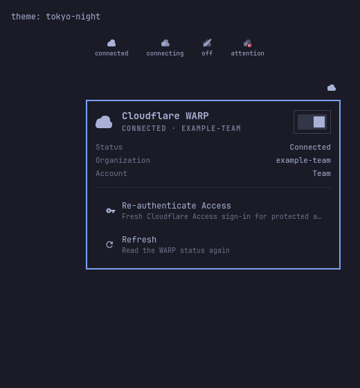
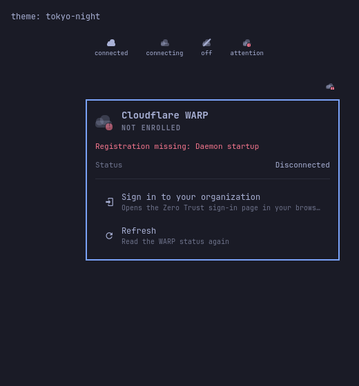
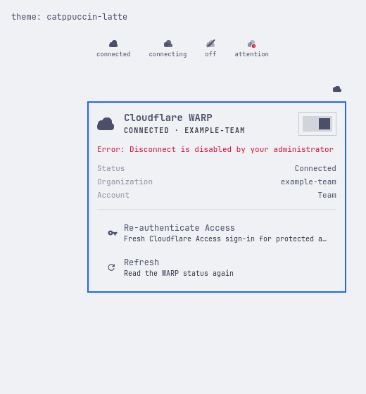
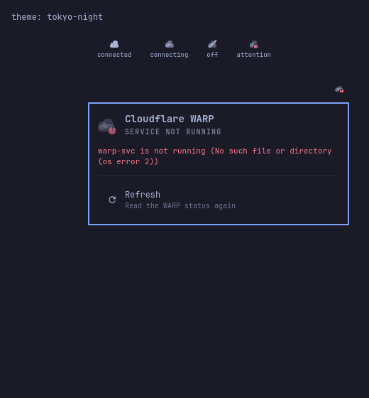

# Cloudflare WARP on Omarchy

Findings and a prototype for putting the company's Cloudflare One (WARP / Zero Trust) client
on an Omarchy work laptop. Status: **prototype, live-checked**. On 2026-11-23 the lab VM
(Omarchy 4.5) was enrolled into the real organization through the widget, with Entra SSO.
See [Live check](#live-check-lab-vm-2026-11-23).

`<team>` is a placeholder for the Zero Trust team name. This public document carries no
organization settings (policy, split tunnel, enrollment details); those live in the
private company package and its docs.

## Summary

- **Bar:** Omarchy 4.5 has no Waybar. The bar is `omarchy-shell` (Quickshell), and
  indicators are `bar-widget` plugins. The prototype is a plugin, `9spokes.warp`, in
  [`9spokes-oss/omarchy-warp`](https://github.com/9spokes-oss/omarchy-warp). It draws a theme-coloured cloud and has a small
  panel with a connect switch, state, reason and organization, plus sign-in, Access
  re-auth and refresh actions.
- **Package:** use Cloudflare's Ubuntu `.deb`, repackaged. Cloudflare publishes no Arch
  package. AUR `cloudflare-warp-bin` repackages it with a pinned SHA-256. Here that
  hash was verified to chain back to Cloudflare's signed apt metadata.
  - Decided: build our own package, without `warp-taskbar`, in the signed company
    repo. The bar widget replaces the taskbar. [`packaging/cloudflare-warp/`](../packaging/cloudflare-warp/)
    holds the recipe and the check for Cloudflare's signature chain.
- **Enrollment:** `mdm.xml` names the organization, and the user enrolls once through the
  browser and Entra. With Chromium's linux-entra-sso the Entra step was silent in the
  live check.
- **CA:** on Arch, one anchor file in `/etc/ca-certificates/trust-source/anchors/` plus
  `update-ca-trust` covers several consumers:
  - OpenSSL, curl and Python, including Arch's `certifi`, which is a symlink to the system bundle;
  - NSS and Chromium, because Arch's `libnssckbi.so` is p11-kit;
  - Java.
  - Node and pip-installed `certifi` still need environment variables.
  - WARP's own certificate installer has no Arch path, so the private company package
    ships the CA (decided).
- **Networking:** Omarchy uses NetworkManager, systemd-resolved (stub) and ufw, the
  resolver model WARP supports on Ubuntu. No conflicts were found on paper. Docker and Tailscale need care (see [Networking](#networking-on-omarchy)).

## 1. How the Linux client is laid out

From Cloudflare's `cloudflare-warp` 2026.8.2115.0 `.deb`, the same build the AUR
repackages. These are facts about the client, not about any organization's settings.

| Item | Value |
|---|---|
| Binaries | `warp-svc` (daemon), `warp-cli`, `warp-diag`, `warp-dex`, and `warp-taskbar` (Flutter/GTK, everything under `/usr/lib/warp`) |
| System unit | `warp-svc.service`: `Type=simple`, `Restart=always`, `After=pre-network.target`, `WantedBy=multi-user.target`. Ambient caps `NET_ADMIN NET_BIND_SERVICE SYS_PTRACE DAC_OVERRIDE NET_RAW SETUID SETGID`. State, runtime and logs in `/var/lib`, `/run`, `/var/log` `cloudflare-warp` |
| User unit | `warp-taskbar.service` (`Type=dbus`), started by `/etc/xdg/autostart/com.cloudflare.WarpTaskbar.desktop` |
| Deep link | `com.cloudflare.warp.desktop` handles `x-scheme-handler/com.cloudflare.warp` by running `warp-cli --accept-tos registration token %u`. This finishes a browser sign-in, and it is separate from the taskbar |
| IPC socket | `/run/cloudflare-warp/warp_service`, mode `srwxrwxrwx`, owned by root. Any local user can query and control the daemon, so the bar widget needs no privilege |
| Interface | `CloudflareWARP` |
| MDM file | `/var/lib/cloudflare-warp/mdm.xml`, read by the daemon (`warp-cli mdm refresh`, `warp-cli mdm get-configs`) |

- **Linking:** `warp-svc`, `warp-cli`, `warp-diag` and `warp-dex` link nothing under
  `/usr/lib/warp`. The taskbar can therefore be left out entirely, and with it the GTK,
  WebKitGTK and Ayatana dependencies.
  - `warp-svc` needs `tpm2-tss`, `nss`, `openssl`, `dbus`, `libcap` and `systemd-libs`.
  - `warp-dex` also needs `libpcap`, `libnl` and `rdma-core` (`libibverbs`). The AUR
    recipe doesn't list these three.
- **DNS:** with systemd-resolved, the client points DNS at its local DoH proxy on
  `127.0.2.2` and `127.0.2.3`, and per-link DNS is left in place.
  - On Arch (lab VM), it set these on its own `CloudflareWARP` link and wrote no
    `resolved.conf.d` drop-in.
  - Cloudflare's removal scripts still clean up a drop-in
    (`/etc/systemd/resolved.conf.d/cloudflare-warp.conf`), so some setups do get one.
- **Gateway CA installer:** strings in `warp-svc` show certificate-store paths for:
  - Debian (`/usr/local/share/ca-certificates`, `update-ca-certificates`);
  - RHEL/Fedora (`/usr/share/pki/ca-trust-source/anchors`);
  - SUSE (`/usr/share/pki/trust/anchors`);
  - NSS databases.

  There is **no Arch path**: Arch's p11-kit reads `/etc/ca-certificates/trust-source` and
  `/usr/share/ca-certificates/trust-source`. So don't count on the client to install the
  Gateway CA into Arch's system store; provision it ourselves (see below).

## 2. Getting the same on Omarchy

### Package source

| Option | Trust story | Verdict |
|---|---|---|
| AUR `cloudflare-warp-bin` 2026.8.2115.0-1 | Downloads Cloudflare's `resolute` (Ubuntu 26.04) `.deb` from `pkg.cloudflareclient.com` and checks it against a SHA-256 pinned by AUR maintainers (4 co-maintainers, 83 votes). Trust on first use per update. | Not chosen |
| **Company-built package in the signed Omarchy repo** (see `omarchy-repo` design) | Same `.deb`, but the PKGBUILD verifies Cloudflare's chain: repo key `C068 A2B5 7717 7519 3CBE 1F2F 6E2D D217 4FA1 C3BA`, then a signed `InRelease`, then the `Packages` SHA-256, then the `.deb` SHA-256. Signed by our repo key. | **Chosen** |
| Cloudflare's own repo | deb/rpm only, no pacman | Not applicable |

- **Chain checked by hand:** `InRelease` dated 2026-10-20 had a good signature from that
  key. The `main/binary-amd64/Packages` SHA-256 is listed in it. `Packages` lists
  `cloudflare-warp 2026.8.2115.0` with SHA-256 `021bfd47…2f5747`, the same hash the AUR
  pins.
- **What the AUR recipe does:**
  - rewrites `/bin` paths to `/usr/bin`;
  - changes the taskbar's `BindsTo=graphical-session.target` to `PartOf=`;
  - fixes the RPATHs;
  - runs `setcap cap_net_admin+ei` in `post_install`. That is redundant, since the unit
    already grants ambient capabilities.
- **AUR dependencies:** `nftables`, `nss`, `tpm2-tss`, plus GTK3, WebKitGTK 4.1 and
  Ayatana AppIndicator for the taskbar. The stock Omarchy lab VM lacks `ayatana-ido` and
  `libayatana-indicator`; both are taskbar-only.
- **Our package ([`packaging/cloudflare-warp/`](../packaging/cloudflare-warp/)) differs
  from the AUR one:**
  - It leaves out `warp-taskbar` entirely: `/usr/lib/warp`, its user unit, its D-Bus
    service and its XDG autostart entry. uwsm sessions start XDG autostart entries, so the
    taskbar would otherwise put a second, unthemed icon in Omarchy's tray.
  - Its dependencies are what the remaining binaries link.
  - It has no `setcap`.
  - It keeps the deep-link handler.
  - It fixes `warp-dex`, which needs Debian's `libpcap.so.0.8`. The package rewrites that
    to Arch's `libpcap.so.1` (same ABI) with `patchelf`. The AUR package skips both the
    libpcap dependency and this fix, so `warp-dex` doesn't load there.
  - Removing it cleans up as Cloudflare's own scripts do: the systemd-resolved drop-in
    `/etc/systemd/resolved.conf.d/cloudflare-warp.conf` and the `inet cloudflare-warp`
    nft table.
  - `verify-upstream.sh` re-checks the signature chain and the pinned hash on each bump.
  - Built and installed in the lab VM:
    - 7 files, and every library resolves after the fix;
    - `warp-svc` is active and enabled;
    - the MDM file is parsed (`warp-cli mdm get-configs`);
    - the unregistered daemon left DNS alone: no resolved drop-in, no `CloudflareWARP`
      interface, and HTTPS still works.
- **Updates:** on Linux, updates come only from the package manager. Bump the company
  package when Cloudflare publishes, re-running the chain check.

### Service

```bash
sudo systemctl enable --now warp-svc.service
```

- The company package can do this through a systemd preset
  (`/usr/lib/systemd/system-preset/50-<company>.preset`, `enable warp-svc.service`), so a
  fresh install comes up enabled.
- An unregistered daemon leaves DNS and routes alone, as observed in the lab VM.
- The bar widget shows "Service not running" until the daemon is up.

### Unattended org enrollment (MDM file)

Install `/var/lib/cloudflare-warp/mdm.xml` as root `0644`. A minimal file for
user-driven enrollment:

```xml
<dict>
  <key>organization</key>
  <string>&lt;team&gt;</string>
  <key>display_name</key>
  <string>&lt;display name&gt;</string>
  <key>onboarding</key>
  <false/>
</dict>
```

- **Where it lives:** the team name is org data, so this file belongs in the private
  company package, not this public repo.
- **Applying a change:** `warp-cli mdm refresh` re-reads it. `warp-cli mdm get-configs`
  shows what the daemon parsed.
- **What happens on first use:** with the MDM organization set, `warp-cli registration
  new` (no argument) registers against that organization, per its `--help`. warp-cli is
  expected to open the browser at the team's Access login; the binary has a
  `FailedToOpenBrowser` error. After the IdP sign-in, the browser hands a
  `com.cloudflare.warp://…` link to the deep-link handler, which runs
  `warp-cli registration token`. The widget's **Sign in to your organization** action
  runs `registration new`.
- **Without the taskbar:** the daemon's own "please enroll" prompt is a desktop
  notification raised by `warp-taskbar`. With the taskbar dropped, the widget's attention
  badge and its **Sign in** action take its place.
- **Fully unattended** (no user) enrollment needs `auth_client_id` and
  `auth_client_secret` for an Access service token. The device then enrolls as a
  non-user identity, which loses per-user Gateway and Access policy. Not recommended for
  laptops.

### Gateway CA, system-wide on Arch

Verified in the lab VM, whose traffic passes through a TLS-inspecting Gateway:

- **System anchor:** the VM trusts the CA through
  `/etc/ca-certificates/trust-source/anchors/cloudflare-host-ca.crt`. `trust list` shows
  it as `trust: anchor`.
- **Consumers that pass with no environment variables:** `curl`, Python `urllib`, and
  Python `requests` all return 200 to an external HTTPS site.
  - Arch's `python-certifi` `cacert.pem` is a symlink to `/etc/ssl/certs/ca-certificates.crt`.
  - OpenSSL's default `cafile` is `/etc/ssl/cert.pem`, which is the p11-kit-extracted bundle.
- **NSS / Chromium:** Arch's `/usr/lib/libnssckbi.so` is a symlink to
  `pkcs11/p11-kit-trust.so`, owned by `nss`. NSS consumers, including Chromium, therefore
  see p11-kit anchors without a `certutil` import.

Steps for a laptop:

```bash
sudo install -Dm644 gateway-ca.pem /etc/ca-certificates/trust-source/anchors/cloudflare-gateway.crt
sudo update-ca-trust
trust list | grep -A2 'Gateway CA'
```

- **Where the PEM comes from (decided):** the private company package ships it. It is a
  public certificate, specific to the Cloudflare account, so it stays out of this repo.
  Mirroring a copy the client writes is not an option on Arch: in the live check the
  client wrote no certificate anywhere.

Per runtime:

| Consumer | On Arch after `update-ca-trust` | Action |
|---|---|---|
| OpenSSL, curl, wget, git, Go, Python `ssl`, system `requests` | system bundle | none |
| Chromium / NSS | p11-kit via `libnssckbi` | none |
| Java | `/etc/ssl/certs/java/cacerts` regenerated by the `update-ca-trust` hook when `ca-certificates-java` is installed | none |
| Node.js | bundles its own roots | `NODE_EXTRA_CA_CERTS=/etc/ssl/certs/ca-certificates.crt`, or `NODE_USE_SYSTEM_CA=1` on Node 23.8+ |
| pip / venv `certifi`, Rust `webpki-roots` | bundled roots | `REQUESTS_CA_BUNDLE` / `SSL_CERT_FILE=/etc/ssl/certs/ca-certificates.crt`; `PIP_CERT` likewise |
| Containers (podman/docker) | image's own store | mount `/etc/ssl/certs/ca-certificates.crt` into the container and set `SSL_CERT_FILE`, or bake the CA into the image |

- **Where to set the variables:** set them for graphical sessions as well as shells.
  Omarchy starts Hyprland through uwsm, and apps run as systemd user units. So use
  `/etc/environment.d/50-gateway-ca.conf`, which the systemd user environment generator
  reads, plus `/etc/profile.d/` for TTY and SSH logins.
- **Not verified on Omarchy:** that uwsm-launched apps pick up `environment.d`.

### Himmelblau and Entra SSO

Verified live in the lab VM on 2026-11-23 (see [Live check](#live-check-lab-vm-2026-11-23)).
The flow:

1. The widget's sign-in action (or `warp-cli registration new`) opens the default
   browser, Chromium on Omarchy, at the team's Cloudflare Access login.
2. Access redirects to Entra as the IdP. That is a top-level navigation to
   `login.microsoftonline.com`, where linux-entra-sso, through Himmelblau's broker,
   attaches the user's PRT-based SSO.
   - This is the extension's core path. It does **not** depend on the `wellKnownApps`
     list in [`examples/chromium-m365-sso.json`](../examples/chromium-m365-sso.json),
     which is for single-page apps.
   - Observed: Entra recognised the user with no account picker, password or MFA.
3. Access redirects to `com.cloudflare.warp://…`. Chromium asks once before opening the
   external protocol; its "always open" box is unticked by default.
   - The company package can remove that prompt with a Chromium managed policy, for
     example `/etc/chromium/policies/managed/warp.json`:

     ```json
     { "AutoLaunchProtocolsFromOrigins": [
         { "protocol": "com.cloudflare.warp",
           "allowed_origins": ["https://<team>.cloudflareaccess.com"] } ] }
     ```

   - Not tested.
4. The deep-link handler runs `warp-cli registration token`, and the daemon connects.
   The widget showed Connected almost at once.

Risks to check when enrolling:

- **Conditional Access.** If the "Cloudflare Access" enterprise app requires a compliant
  device, Omarchy's Intune state applies: [intune-sso.md](intune-sso.md) records the lab
  VM as Not compliant. The sign-in then fails at Entra, not at WARP.
- **WARP device posture.** Any Zero Trust device-posture rules (OS version, disk
  encryption, serial number) evaluate Linux attributes. `warp-cli debug posture` shows
  what the client reports.
- **Session lifetime.** When the Access session expires, the user must sign in again.
  The widget's **Re-authenticate Access** (`warp-cli debug access-reauth`) covers that by
  hand. With the taskbar dropped, how an expired session shows up in `warp-cli status`
  still has to be observed.
- **Interaction with Himmelblau itself:** none found. WARP doesn't use PAM, NSS or the
  Himmelblau daemons. Himmelblau's traffic to Entra then goes through WARP like any
  other traffic.

### Networking on Omarchy

From the lab VM (Omarchy 4.5):

- **Network and DNS:** NetworkManager 1.58 with systemd-resolved enabled, and
  `/etc/resolv.conf` pointing at `stub-resolv.conf`. No iwd or systemd-networkd service
  is enabled. WARP sets resolved's global DNS to its proxy, as it does on Ubuntu. No
  change is expected to be needed.
- **ufw** is enabled: deny incoming, allow outgoing, plus Docker DNS rules. WARP manages
  its own nftables table; ufw uses iptables-nft. No conflict is expected, but it is not
  verified under load.
- **Docker** is installed but not enabled. Check that the Docker and Podman bridge ranges
  are excluded from the tunnel by the Zero Trust split-tunnel settings. Otherwise container traffic to the
  bridge gateway, including the DNS that ufw allows, may be steered into the tunnel.
- **NetworkManager's connectivity check** (`http://ping.omacom.io/nm-check.txt`) goes
  through Gateway. If Gateway blocks or rewrites it, NetworkManager reports "limited
  connectivity". WARP has its own captive-portal detection.
- **Tailscale** (Omarchy ships a Tailscale widget): running both clients means two
  daemons competing for DNS and routes. Pick one per device, or test MagicDNS with WARP's
  local DNS proxy.

## 3. Indicator

### warp-taskbar: dropped

**Decision:** don't ship `warp-taskbar`; the bar widget replaces it. Why, from the
package and Omarchy's source (it was never run under Hyprland):

- **It is a Flutter/GTK3 app that uses `tray_manager`**, through Ayatana AppIndicator,
  so it exports a StatusNotifierItem. Omarchy's `omarchy.tray` (Quickshell
  `SystemTray`) would show it.
- **It can't be themed.**
  - The tray recolours only icons whose names end in `-symbolic`. WARP ships
    full-colour PNG/ICO tray icons (`connected.png`, `disconnected.png`, `attention*.png`).
  - Its window is a fixed-style Flutter UI with a WebKit view.
- **It is also the GUI half of enrollment prompts and notifications.** Without it, those
  notifications are gone. The widget covers the state, and the sign-in and re-auth
  actions.

### Prototype: `9spokes.warp` bar widget

[`9spokes-oss/omarchy-warp`](https://github.com/9spokes-oss/omarchy-warp) is a third-party `bar-widget` plugin, with
`manifest.json` at the repo root. It passes `omarchy plugin validate` in the VM.

- **Theme:** colours come from the bar facade (`bar.barForeground`, `bar.urgent`) and
  `Commons.Color`, and sizes from `Style`, as in first-party widgets. The icon is drawn
  from QML rectangles, so it takes the theme's colours. It is a generic cloud, not
  Cloudflare's logo.
- **State source:** `warp-cli --accept-tos -j status`, polled every 30 s by default.
  - A long-lived `warp-cli -l status` re-polls whenever it prints anything.
  - In the lab VM, over a plain pipe and unbuffered, it printed the current state at once
    (`Status update: Unable` / `Reason: Registration Missing due to: Daemon Startup`).
    It printed another line on each daemon event, for example `Status update: List of
    local policy configurations was updated` after `warp-cli mdm refresh`. Polling stays
    as the fallback.
  - The stream is used only as a trigger, so the widget doesn't depend on its format.
  - When the listener exits, it is retried with a doubling delay up to 60 s. The delay
    resets only after the listener prints something or stays up for 30 s.
- **Sign-in and re-auth** run in their own process, separate from connect and disconnect:
  - output is streamed, so a printed URL opens at once;
  - the flow is abandoned after 5 minutes;
  - the switch stays usable meanwhile.
- **Terms of service:** every call passes `--accept-tos`. Without a TTY, warp-cli would
  otherwise wait for an answer. This is accepted, since the company deploys the client.
- **States** (see `Model.js`):
  - Connected, Connecting, Disconnecting, Disconnected, Paused, Unable;
  - Not enrolled: any reason containing `RegistrationMissing`. A fresh daemon on Arch
    reports `{"status":"Unable","reason":{"RegistrationMissing":"DaemonStartup"}}`
    (captured in the VM);
  - Service not running: the JSON error `{"code":"FailedToConnectToDaemon"}`, captured
    from the real CLI with the socket hidden;
  - Not installed: warp-cli is not on PATH;
  - Unknown: shown raw, with the badge.
- **Clicks:**
  - left opens the panel;
  - right connects or disconnects;
  - middle refreshes;
  - IPC: `omarchy-shell 9spokes.warp status|toggle|connect|disconnect|signIn|refresh|open|close`.
- **Policy refusals:** a non-zero exit from `disconnect` (for example "disabled by your
  administrator") is shown in the panel, and the switch springs back.
- **Privacy:** the registration parser keeps only the organization name and account type.
  Ids, keys and fingerprints never reach QML.

Tests:

Both live in the plugin repo.

- `make test` (`tests/model.test.mjs`) checks the parser against captured
  and expected outputs.
- [`tests/harness/run.sh`](https://github.com/9spokes-oss/omarchy-warp/blob/main/tests/harness/run.sh) renders the real
  `Panel.qml` and `Service.qml` offscreen on an Omarchy machine. It needs no compositor,
  root or WARP. It uses:
  - Omarchy's `qs.Commons` and `qs.Ui` with a chosen theme;
  - a fake `warp-cli`;
  - a stub `KeyboardPanel`, because the offscreen platform has no layer-shell windows,
    so the popup's window chrome and placement are not exercised.

Lab results (VM, Quickshell 0.3.2):

- All six states rendered in `tokyo-night`, plus `catppuccin-latte` (light), `gruvbox`
  and `rose-pine`.
- **Sign-in over IPC (`signIn`):** the fake takes 3 s to register. The panel showed
  "Waiting for the browser sign-in…" with the sign-in row disabled, then Connected, and
  it re-read the registration.
- **Listener retry:** with a fake `-l` that exits at once, it respawned 4 times in 22 s.
- **IPC run** against the live harness:
  - `disconnect` gave Disconnected;
  - `connect` gave Connected;
  - with the fake policy lock, `disconnect` was refused, the error showed, and the state
    stayed Connected.
- **warp-cli calls:** the fake logged one listener, status polls, and one
  `registration show` per enrollment.

| Dark (`tokyo-night`), connected | Dark, not enrolled | Light (`catppuccin-latte`), disconnect refused by policy |
|---|---|---|
|  |  |  |

Icon states in `gruvbox`: . Service down:
.

Install for one user:

```bash
omarchy plugin add https://github.com/9spokes-oss/omarchy-warp.git --enable --yes
```

## 4. Packaging recommendation

Split it by who owns each piece:

1. **`cloudflare-warp`, built and signed in the company's Omarchy repo** from
   [`packaging/cloudflare-warp/`](../packaging/cloudflare-warp/). The PKGBUILD has no org
   data, so it stays in this public repo; the signed repo builds and signs it.
2. **System package (private company repo)**, e.g. `<company>-warp`:
   - depends on that `cloudflare-warp`;
   - installs `mdm.xml` with the team name, the Gateway CA anchor,
     the `environment.d` and `profile.d` CA variables, and a preset that enables `warp-svc`;
   - is org-specific, so it must not live in this public repo.
3. **Omarchy plugin `9spokes.warp` in its own public git repo**, `9spokes-oss/omarchy-warp`:
   - `omarchy plugin add` clones one repo per plugin with `manifest.json` at its root,
     and plugins install per user under `~/.config/omarchy/plugins/`. A pacman package
     can't install it system-wide.
   - It has no org data. Users, or a first-login hook, run
     `omarchy plugin add https://github.com/9spokes-oss/omarchy-warp.git --enable --yes`.
4. **Not in `omarchy-himmelblau`.** WARP doesn't depend on Himmelblau, and the companion
   is scoped to sign-in and lock. Mention WARP only in docs, and keep the two
   independently installable.

## Live check (lab VM, 2026-11-23)

The lab VM runs Omarchy 4.5 with Himmelblau. It got the taskbar-less package and the
organization's `mdm.xml`; the work user then signed in from the widget.

| Step | Result |
|---|---|
| Install (`packaging/cloudflare-warp`) | Built and installed; `warp-svc` enabled and active. Unregistered status `{"status":"Unable","reason":{"RegistrationMissing":"DaemonStartup"}}` |
| Widget before enrollment | Faded cloud with the urgent `!` badge, and a **Sign in to your organization** action |
| Sign-in | Chromium opened the team's Access page. Entra SSO through linux-entra-sso was silent. Chromium asked once to open `com.cloudflare.warp`. The widget showed Connected almost at once |
| Connected state | `{"status":"Connected","reason":"NetworkHealthy"}`, MASQUE tunnel, HTTPS through Gateway verified (`curl` 200, verify 0) |
| Right-click disconnect / reconnect | Worked from the real bar. A manual disconnect reports `{"status":"Disconnected","reason":"Paused"}` |
| Gateway CA | The client wrote **nothing**: no `installed_cert.pem`, no new file in any CA store, no NSS DB. TLS still worked only because the lab VM already had the CA as a p11-kit anchor. Provision the CA in the package |

**Lab caveat: SSH into the VM stops while WARP is connected.**
- `ip route get 10.0.2.2` shows replies to QEMU's NAT host going through the
  `CloudflareWARP` routing table, so inbound SSH times out.
- The same applies on a real laptop to any LAN range that isn't excluded from the tunnel.
- In the lab, disconnect from the widget to get SSH back. Or, if the host also runs WARP
  in an organization that routes device-to-device (WARP-to-WARP) traffic, SSH to the
  VM's WARP address instead; that worked with the VM connected. Reuse the forwarded
  port's host key with `-o HostKeyAlias=[127.0.0.1]:2222`.

**Found on the way, not WARP:**
- The login screen kept Entra's number-match message out of sight. Its message area is
  clipped and doesn't scroll to the newest line; scrolling it by hand reveals the number.
- It came up because Entra asked for a fresh MFA at login (`AADSTS70044`).
- Reported to the session that owns the greeter theme.

## Decisions

- **Taskbar:** dropped; the bar widget replaces it.
- **Terms of service:** the widget's `--accept-tos` on every call is accepted.
- **Organization settings:** kept out of this public repo.
- **Live check:** approved, enrolling a lab machine into the real organization, with the
  user signing in.
- **Package source:** our `cloudflare-warp` PKGBUILD, built and signed in the company's
  Omarchy repo. Not the AUR package.
- **CA delivery:** the private company package ships the Gateway CA as a p11-kit anchor,
  with the runtime variables.
- **Plugin home:** its own public repo, [`9spokes-oss/omarchy-warp`](https://github.com/9spokes-oss/omarchy-warp), created 2026-11-23.

## Next steps

1. Add `cloudflare-warp` to the company's signed repo build.
2. Write the private `<company>-warp` package: `mdm.xml`, the CA anchor and variables,
   the `warp-svc` preset, and optionally the Chromium protocol policy.

## Not verified

- How an expired Access session or a posture failure shows up in `warp-cli status`, and
  so in the widget.
- The `AutoLaunchProtocolsFromOrigins` policy that would skip Chromium's protocol prompt.
- Live theme switching. Omarchy pushes themes to the shell over `applyTheme` IPC, and the
  harness doesn't host that. The widget only binds to the same tokens as first-party
  widgets.
- uwsm picking up `/etc/environment.d`.
- A screenshot of the widget in the live bar. The VM's framebuffer dumps come out
  smeared, so the offscreen renders above stand in for one.
